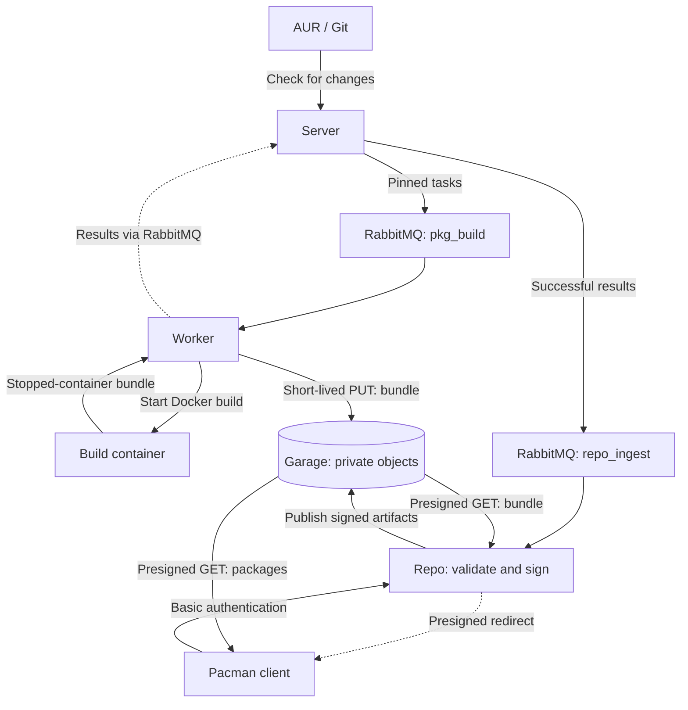

# Architecture

AUR Builder separates scheduling, execution, publication, and client downloads.

## Components

| Module | Responsibility |
| --- | --- |
| `server` | Source checks, task persistence, approvals, and result processing |
| `worker` | Runs Docker build containers and reports results |
| `build-container` | Fetches sources, installs dependencies, runs `makepkg`, and writes a bundle |
| `repo` | Validates artifacts, signs packages/databases, publishes the catalog, and authenticates downloads |
| `web` (Nuxt/Nitro, PrimeVue, Prisma, oRPC) | OIDC login, permissions, source diffs, approval queue, history, logs, and rebuilds |
| `notifier` | Optional SMTP notifications |
| `database` | Shared SQL access and migrations |
| `common` | Configuration, message types, S3 signing, and messaging helpers |

## Task and upload flow

The server captures immutable packaging revisions as pending release candidates.
Human approval or configured AI approval records a decision and a queued task in
one database transaction. Each task pins the approved commit and has a
unique attempt ID and private bundle object key. No upload grant is queued.
Pending task records allow recovery after a crash before broker confirmation.

Workers hold storage credentials and a receipt-authentication key outside the sandbox.
An Arch build container receives the approved revision, source, options, and safe
package environment settings. It writes `/results/bundle.tar` and an atomic completion record. The worker
exports bounded bytes into private storage, freezes the container, hashes the private copy, issues
a PUT grant lasting at most 900 seconds, uploads it, and publishes an authenticated
receipt. Ingestion verifies both the receipt and actual bundle bytes before signing.
The receipt binds the attempt, candidate, revision, object key, byte count, and digest.
Upload failures fail the build; logs remain in the SQL build-result flow.

`expired_tasks` remains only for legacy task recovery during coordinated upgrades;
normal dispatch no longer includes expiring capabilities.

## Repository publication

The server validates result identity and forwards successful builds to `repo_ingest`.
The repo service downloads the bundle using a signed GET, validates packages and
split outputs, and signs packages with the configured GPG key. `repo-add` builds
pacman `.db` and `.files` databases, which are also signed.

All objects are uploaded before the published catalog switches. Attempt freshness
is checked as part of the SQL catalog update. Duplicate ingestion is idempotent,
and superseded attempts cannot replace the latest publication.

Published filenames are immutable. Different bytes under an existing filename
require a `pkgrel` or `pkgver` increase.

## Queues and failure handling

| Queue | Purpose |
| --- | --- |
| `pkg_build` | Build tasks |
| `build_results` | Worker results |
| `expired_tasks` | Tasks needing a refreshed upload grant |
| `repo_ingest` | Successful builds awaiting publication |
| `repo_ingest_failed` | Rejected artifacts and malformed ingestion messages |
| `notifications` | SMTP notifications |

Messages are durable and publishers verify broker confirmations before acknowledging
upstream deliveries. Transient ingestion failures retry; invalid artifacts are
dead-lettered. A stopped background consumer causes the service to exit so its
restart policy can recover unacknowledged messages.

## Client downloads

A client requests `/REPO/os/x86_64/FILE` with Basic authentication. The repo service
resolves the published catalog entry and returns a temporary signed S3 redirect.
The package bytes travel directly from Garage to the client. GET, HEAD, and range
downloads are supported; authenticated redirects must not be cached.
