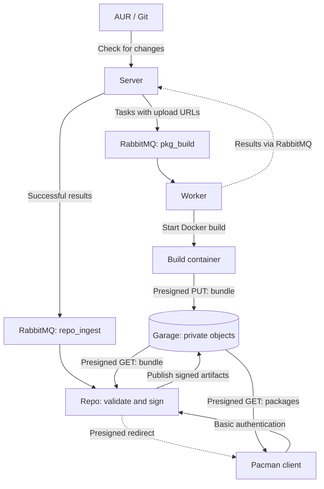

# Architecture

AUR Builder separates scheduling, execution, publication, and client downloads.

## Components

| Module | Responsibility |
| --- | --- |
| `server` | Source checks, task persistence, upload grants, and result processing |
| `worker` | Runs Docker build containers and reports results |
| `build-container` | Fetches sources, installs dependencies, runs `makepkg`, and uploads a bundle |
| `repo` | Validates artifacts, signs packages/databases, publishes the catalog, and authenticates downloads |
| `web` | Dashboard, history, logs, and rebuild requests |
| `notifier` | Optional SMTP notifications |
| `database` | Shared SQL access and migrations |
| `common` | Configuration, message types, S3 signing, and messaging helpers |

## Task and upload flow

The server records a metadata change and its queued task together. Each task has a
unique attempt ID, private bundle object key, presigned PUT URL, and URL expiry.
Pending task records allow recovery after a crash before broker confirmation.

Workers receive no S3 access keys. A worker starts an Arch container with the
source, build options, environment, and task upload URL. Successful outputs are
bundled and uploaded before the result is published. Upload failure is a build
failure. Logs remain in the SQL build-result flow.

Expired queued tasks return through `expired_tasks`; the server validates them and
can issue a new attempt. A build that exceeds its upload grant must be rebuilt.

## Repository publication

The server validates result identity and forwards successful builds to `repo_ingest`.
The repo service downloads the bundle using a signed GET, validates packages and
split outputs, and signs packages with the configured GPG key. `repo-add` builds
pacman `.db` and `.files` databases, which are also signed.

All objects are uploaded before the published catalog switches. Attempt freshness
is checked as part of the SQL catalog update. Duplicate ingestion is idempotent,
and superseded attempts cannot replace the latest publication.

Published filenames are immutable. Different bytes under an existing filename
require a `pkgrel` or `pkgver` increase.

## Queues and failure handling

| Queue | Purpose |
| --- | --- |
| `pkg_build` | Build tasks |
| `build_results` | Worker results |
| `expired_tasks` | Tasks needing a refreshed upload grant |
| `repo_ingest` | Successful builds awaiting publication |
| `repo_ingest_failed` | Rejected artifacts and malformed ingestion messages |
| `notifications` | SMTP notifications |

Messages are durable and publishers verify broker confirmations before acknowledging
upstream deliveries. Transient ingestion failures retry; invalid artifacts are
dead-lettered. A stopped background consumer causes the service to exit so its
restart policy can recover unacknowledged messages.

## Client downloads

A client requests `/REPO/os/x86_64/FILE` with Basic authentication. The repo service
resolves the published catalog entry and returns a temporary signed S3 redirect.
The package bytes travel directly from Garage to the client. GET, HEAD, and range
downloads are supported; authenticated redirects must not be cached.
